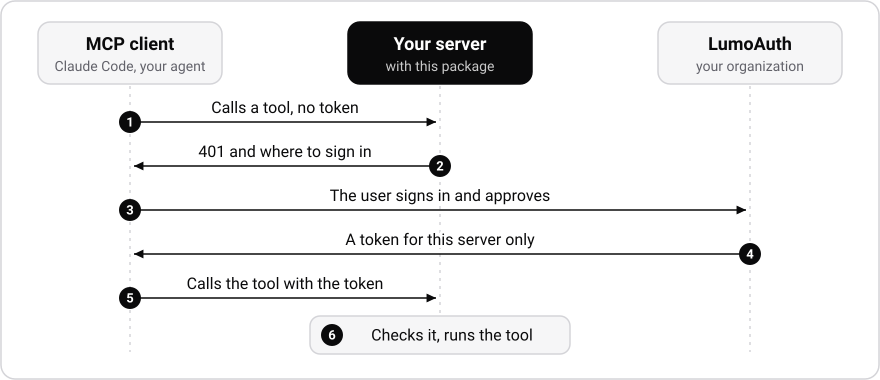

<div align="center">

<a href="https://lumoauth.dev">
  <picture>
    <source media="(prefers-color-scheme: dark)" srcset="https://docs.lumoauth.dev/img/lumoauth-logo-horizontal-reversed.svg">
    
  </picture>
</a>

# LumoAuth for FastMCP

**Add sign-in and per-tool access control to a FastMCP server in three lines.**

[](https://pypi.org/project/lumoauth-fastmcp/)
[](#requirements)
[](https://gofastmcp.com)
[](#license)

[Quick start](#quick-start) · [How it works](#how-it-works) · [Who is calling](#who-is-calling) · [Scopes and callers](#scopes-and-callers) · [Step-up approval (JIT)](#step-up-approval-for-sensitive-tools-jit) · [Token Vault](#calling-third-party-apis-with-token-vault) · [Per-tool policy](#per-tool-policy-from-lumoauth) · [Tracing](#distributed-tracing-traceparent) · [Troubleshooting](#troubleshooting) · [Docs](https://docs.lumoauth.dev/mcp/)

</div>

---

```python
from fastmcp import FastMCP
from lumoauth_fastmcp import LumoAuthProvider

mcp = FastMCP("Invoices", auth=LumoAuthProvider())
```

Set `LUMOAUTH_ORG_ID` and `LUMOAUTH_MCP_SERVER_ID`, and that is the whole integration. [LumoAuth](https://lumoauth.dev) signs users in and issues the tokens. Your server checks each token and runs the tool.

<table>
<tr>
<td width="33%" valign="top">

**Standard discovery**<br>
MCP clients read one well-known address on your server to find LumoAuth. No custom handshakes.

</td>
<td width="33%" valign="top">

**Sign-in and consent**<br>
LumoAuth shows the sign-in and consent screens. Your server never handles a password.

</td>
<td width="33%" valign="top">

**Token checks on your server**<br>
Each request is checked locally: signature, issuer, audience, expiry and DPoP binding.

</td>
</tr>
<tr>
<td valign="top">

**The verified caller**<br>
`current_caller()` returns a person, an AI agent, or an agent that acts for a person.

</td>
<td valign="top">

**Rules per tool**<br>
Require a scope, a person or an agent capability with one argument.

</td>
<td valign="top">

**Policy in LumoAuth**<br>
Grant each tool to a person or an agent in LumoAuth. A change applies within 30 seconds, without a restart.

</td>
</tr>
<tr>
<td valign="top">

**Step-up approval (JIT)**<br>
Require human approval (`require_jit` / `ensure_jit`) before an agent can run a high-risk tool or touch a specific record.

</td>
<td valign="top">

**Token Vault for SaaS APIs**<br>
Fetch short-lived GitHub, Slack, or Jira tokens (`auth.vault_token(...)`) scoped automatically to the current caller.

</td>
<td valign="top">

**Trace correlation**<br>
Propagate W3C `traceparent` headers so every tool authorization and Vault call links to your agent trace in LumoAuth's audit log.

</td>
</tr>
</table>

## Quick start

You need Python 3.10 or later and a LumoAuth organization. [Create an organization](https://app.lumoauth.dev/register) if you do not have one yet.

### 1. Register your server

In the LumoAuth portal:

1. Open **AI Agents → MCP servers** and click **Register MCP server**.
2. Set **Server name** to `Invoices` and **Resource URI** to `http://localhost:8000/mcp`.
3. Click **Next** twice, then click **Register MCP server**.
4. On the server's page, click **Edit**, then **Next**. Make two changes:
   - Under **Scopes**, click **Use defaults**.
   - Switch off **Require DPoP sender-constrained tokens**. Claude Code and the FastMCP client do not send DPoP proofs, so they cannot connect while this switch is on.
5. Click **Next**, then **Save changes**. Copy the **Server id** (`mcp_…`) from the top of the page.

The **Resource URI** is the exact URL that clients connect to. A token for one Resource URI does not work at another.

### 2. Run the server

```bash
pip install lumoauth-fastmcp
```

Save this as `server.py`:

```python
from fastmcp import FastMCP
from lumoauth_fastmcp import LumoAuthProvider, current_caller

mcp = FastMCP("Invoices", auth=LumoAuthProvider())

@mcp.tool
def whoami() -> str:
    """Show who is calling."""
    return current_caller().sub

if __name__ == "__main__":
    mcp.run(transport="http", port=8000)
```

Start it with your organization's slug and the server id from step 1. The slug is the part after `/orgs/` in the portal's URL.

```bash
export LUMOAUTH_ORG_ID=acme
export LUMOAUTH_MCP_SERVER_ID=mcp_0123456789abcdef01234567
python server.py
```

For the EU region, also set `LUMOAUTH_URL=https://eu.app.lumoauth.dev`.

### 3. Call it without a token

```console
$ curl -i http://localhost:8000/mcp
HTTP/1.1 401 Unauthorized
www-authenticate: Bearer scope="mcp:read", resource_metadata="http://localhost:8000/.well-known/oauth-protected-resource/mcp"
```

Your server now rejects calls without a token. The `401` tells MCP clients where to find LumoAuth.

### 4. Sign in from a client

First, create an application for the client in the portal:

1. Open **Applications**, click **New application** and choose **Single-page or mobile app**.
2. Set **Application name** to `Local MCP client` and **Redirect URI** to `http://localhost:8765/callback`.
3. Click **Create application** and copy the **Client ID**.
4. On the **Configuration** tab, set **Scopes** to `openid profile email offline_access mcp:read`. Click **Save configuration**.

Then save this as `client.py`, with your client ID:

```python
import asyncio

from fastmcp import Client
from fastmcp.client.auth import OAuth

auth = OAuth(client_id="client_0123456789abcdef0123456789abcdef", callback_port=8765)

async def main():
    async with Client("http://localhost:8000/mcp", auth=auth) as client:
        result = await client.call_tool("whoami")
        print(result.data)

asyncio.run(main())
```

Run it in a second terminal:

```console
$ python client.py
01a18f7f-fe26-7f38-b46a-ac6bfabfbb78
```

Your browser opens on the LumoAuth sign-in page. After you sign in and approve, the script prints your user id. Your tool read that id from the verified token.

<details>
<summary><strong>Connect Claude Code instead</strong></summary>

<br>

Use the same application:

```bash
claude mcp add --transport http \
  --client-id client_0123456789abcdef0123456789abcdef \
  --callback-port 8765 \
  invoices http://localhost:8000/mcp

claude mcp login invoices
```

Your browser opens on the same sign-in page. Then `claude mcp list` shows the connection:

```console
invoices: http://localhost:8000/mcp (HTTP) - ✔ Connected
```

</details>

Other MCP clients connect the same way if they let you set a client ID and a callback port. [Troubleshooting](#troubleshooting) explains the errors that you may see.

### Before you go to production

- Register a separate server with your public `https://` address. LumoAuth accepts plain `http://` only for `localhost`, `127.0.0.1` and `[::1]`.
- Under **Allowed clients**, choose **Only the clients I pick**.
- Switch on **Require DPoP sender-constrained tokens** if all your clients can send proofs. See [DPoP](#dpop).

## How it works

<p align="center">
  <picture>
    <source media="(prefers-color-scheme: dark)" srcset="https://raw.githubusercontent.com/LumoAuth/mcp-fastmcp/main/assets/how-it-works-dark.svg">
    
  </picture>
</p>

LumoAuth is the authorization server. It shows the consent screen and issues access tokens whose audience is your server's Resource URI. Your FastMCP server stays a resource server, and the provider gives it what the MCP specification asks of one:

- **Discovery.** The server publishes protected resource metadata at `/.well-known/oauth-protected-resource/...`. This document names your LumoAuth organization as the authorization server.
- **Challenges.** A request without a valid token gets `401` with a `WWW-Authenticate` header that points to that document. The challenge names the scopes that the registration advertises. It also states the real reason when a token is rejected: expired, wrong audience, replayed DPoP proof, and so on.
- **Verification.** Tokens are verified locally: signature against the organization's keys, issuer, audience, expiry, `at+jwt` type, and no portal test tokens. A DPoP-bound token must arrive with the `DPoP` scheme and a fresh proof for this request.
- **Identity.** Tools get the verified caller: a user, an AI agent, or an agent acting for a user.

The provider reads the server's registration from LumoAuth once at start-up: the Resource URI, the advertised scopes, and whether only DPoP-bound tokens are accepted. Restart the server after you change the registration.

Authentication applies to HTTP transports. A server that runs over stdio is started by the user's own MCP client and has no OAuth step.

## Who is calling

`current_caller()` returns the verified claims of the current request as `lumoauth.verify.AccessTokenClaims`. This is the same object that `verify_access_token` in the LumoAuth Python SDK returns.

```python
from lumoauth_fastmcp import current_caller

@mcp.tool
def list_invoices() -> list[dict]:
    caller = current_caller()
    if caller.is_agent:
        log.info("agent %s", caller.agent_id)          # "agt_…"
    elif caller.is_delegated:
        log.info("agent %s for user %s", caller.actor, caller.sub)
    return invoices_for(caller.sub)
```

`current_caller()` returns `None` on transports without OAuth, such as stdio and in-memory clients.

| Property | Meaning |
| --- | --- |
| `caller.sub` | The user ID, or `agent_agt_…` for an autonomous agent |
| `caller.is_agent`, `caller.agent_id` | `True` for an AI agent, and its `agt_…` ID |
| `caller.is_delegated`, `caller.actor` | `True` when an agent acts on behalf of the user `caller.sub` |
| `caller.scopes`, `caller.capabilities` | Granted OAuth scopes and agent capabilities |
| `caller.is_jit`, `caller.authorization_details` | `True` when the caller holds a Just-in-Time (RFC 9396) approval, and its granted details |
| `caller.traceparent`, `caller.trace_id` | The validated W3C `traceparent` header and 32-character trace ID of the request |

## Scopes and callers

Pass the checks to FastMCP's `auth=` argument or to `AuthMiddleware`:

```python
from fastmcp.server.middleware import AuthMiddleware
from lumoauth_fastmcp import require_agent, require_scopes, require_user

@mcp.tool(auth=require_scopes("invoices:refund"))
def refund(invoice_id: str) -> str: ...

@mcp.tool(auth=require_user())                       # people only, no agents
def change_bank_details(iban: str) -> str: ...

@mcp.tool(auth=require_agent("billing.reminders"))   # agents with this capability
def send_reminder(invoice_id: str) -> str: ...
```

`require_user(allow_delegation=True)` also admits an agent that acts for a person.

Add a new scope in two places: the server's **Scopes**, and the **Scopes** of each application that may ask for it. The checks follow LumoAuth's rule: a granted scope that ends in `:*` (such as `invoices:*`) covers the scopes under it, such as `invoices:refund`. Every other scope compares exactly. Prefer narrow scopes, because the MCP security best practices list wildcard scopes as a common mistake.

A component-level check hides the component from callers who fail it. To get an `insufficient_scope` step-up instead, put the scope check in `AuthMiddleware`. The client can then ask the user for the missing scope.

```python
mcp = FastMCP(
    "Invoices",
    auth=LumoAuthProvider(),
    middleware=[AuthMiddleware(auth=require_scopes("invoices:read"))],
)
```

## Step-up approval for sensitive tools (JIT)

**Why it is useful:** Some tools—such as refunding an invoice, wiring money, or deleting a production database—are too risky for an AI agent to run with a standing token alone. With Just-in-Time (JIT) authorization (RFC 9396 Rich Authorization Requests), your tool requires a short-lived approval for that specific action or record. When an agent calls the tool without one, the server rejects the call with an `insufficient_authorization_details` hint telling the agent exactly what approval to ask a human for (for example, via Slack or mobile push).

### Guarding a tool with `require_jit` and `ensure_jit`

Use `require_jit()` on `@mcp.tool(auth=...)` for static action requirements, and `ensure_jit()` inside the tool body when the required `identifier` or `locations` depend on the runtime arguments passed to the tool:

```python
from lumoauth_fastmcp import ensure_jit, require_jit

# 1. Declarative check: hides the tool until the caller has a "payment_initiation" grant
@mcp.tool(auth=require_jit("payment_initiation", actions=["refund"]))
def refund(invoice_id: str) -> str:
    # 2. Argument-bound check: ensures the JIT approval covers THIS specific invoice_id
    ensure_jit("payment_initiation", actions=["refund"], identifier=invoice_id)
    return f"Refunded {invoice_id}"
```

### Keeping the tool visible for automatic agent step-up

If you want agents to see the tool in `tools/list` with their normal MCP token and receive the `insufficient_authorization_details` step-up hint when they call `tools/call`, either call `ensure_jit(...)` inside the tool body or configure `jit=` on `auth.tool_policy()`:

```python
auth = LumoAuthProvider()
mcp = FastMCP(
    "Invoices",
    auth=auth,
    middleware=[
        auth.tool_policy(
            jit={"refund": {"type": "payment_initiation", "actions": ["refund"]}}
        )
    ],
)
```

### How clients send a JIT token

A client can present its JIT approval in two ways:
1. Directly inside the MCP access token (`authorization_details` or `permissions.authorization_details`).
2. Alongside its normal MCP token in the `X-LumoAuth-Jit-Token` HTTP header. `LumoAuthProvider` verifies the JIT token's signature, expiry, and issuer against your organization's JWKS, confirms that its `sub` matches the MCP caller (`caller.sub` or `caller.actor`), and merges its `authorization_details` into `current_caller().authorization_details`.

## Calling third-party APIs with Token Vault

**Why it is useful:** Most MCP tools exist to call an external API such as GitHub, Slack, Jira, Google Workspace, or Salesforce. Hardcoding a shared API key in your MCP server gives every user and agent the same privileges, while forwarding the caller's own OAuth token violates the MCP specification. LumoAuth's Token Vault holds encrypted refresh tokens in custody and mints short-lived outbound access tokens on demand.

### Fetching a token with `auth.vault_token()`

Set `LUMOAUTH_AGENT_TOKEN` (or `LUMOAUTH_MCP_CLIENT_ID` and `LUMOAUTH_MCP_CLIENT_SECRET`), then call `auth.vault_token(connection_id)` inside your tool:

```python
import requests
from fastmcp import FastMCP
from lumoauth_fastmcp import LumoAuthProvider

auth = LumoAuthProvider()
mcp = FastMCP("Engineering", auth=auth)

@mcp.tool
def create_github_issue(repo: str, title: str) -> dict:
    # Fetches a short-lived GitHub token from LumoAuth's Token Vault
    gh_token = auth.vault_token("conn_github_prod")

    response = requests.post(
        f"https://api.github.com/repos/{repo}/issues",
        headers={**gh_token.headers(), "Accept": "application/vnd.github+json"},
        json={"title": title},
        timeout=10,
    )
    response.raise_for_status()
    return response.json()
```

### Automatic user delegation

`auth.vault_token()` inspects `current_caller()` automatically:
- **Person or delegated agent (`not caller.is_agent` or `caller.is_delegated`):** Passes `{"user_id": caller.sub}` to LumoAuth so the tool acts with that specific user's connected account.
- **Autonomous agent (`caller.is_agent` without delegation):** Requests the agent's own connection token.
- **Explicit override:** Pass `auth.vault_token("conn_github_prod", user_id="...")` to request a specific user's grant.

Returned `VaultToken` objects are cached in memory until 30 seconds before `expires_at` (`auth.vault(cache_ttl=60.0)`), so calling `vault_token()` multiple times in one turn does not make repeated network trips.

## Per-tool policy from LumoAuth

A valid token proves that the caller may reach the server. `tool_policy()` also asks LumoAuth about each tool. It hides the tools that a caller may not run, and it rejects calls to them.

```python
auth = LumoAuthProvider()
mcp = FastMCP("Invoices", auth=auth, middleware=[auth.tool_policy()])
```

The server asks as itself. It never forwards the caller's token, which the MCP specification forbids.

**Every tool is denied until you grant it.** With the policy on and no grants, a caller gets an empty list of tools. Set it up once:

1. **Create the server's own application.** Open **Applications**, click **New application** and choose **Machine to machine**. Copy the **Client ID** and the **Client secret**, which is shown only once.
2. **Allow the scope.** On the application's **Configuration** tab, set **Scopes** to `mcp:authorize`. The form also asks for a redirect URI, which this application does not use, so enter any `https://` URL. Click **Save configuration**.
3. **Connect it to the MCP server.** Edit the server. In the step **Who may connect and how**, select the application under **Per-tool authorization**.
4. **Give the server its credentials**, then restart it:

   ```bash
   export LUMOAUTH_MCP_CLIENT_ID=...
   export LUMOAUTH_MCP_CLIENT_SECRET=...
   ```

5. **Grant access.** Open **Relationships**. Under **Namespaces**, create the namespace that you need, with the relation `invoke`. Then, under **Tuples**, add one relationship for each grant:

   | To grant | Object namespace | Object ID | Relation | Subject |
   |---|---|---|---|---|
   | Every tool on the server | `mcp_server` | `mcp_0123456789abcdef01234567` | `invoke` | `user` and the user's id |
   | One tool | `mcp_tool` | `mcp_0123456789abcdef01234567/refund` | `invoke` | `agent` and the agent's id |

Relationships are part of the Fine-grained authorization add-on. Without it, every tool is denied.

Decisions are cached for 30 seconds (`tool_policy(cache_ttl=...)`), so a change takes effect within that time. When LumoAuth cannot be reached, the tool is rejected.

## Distributed tracing (`traceparent`)

**Why it is useful:** When an AI agent runs a multi-step workflow traced in Langfuse, LangSmith, Arize, or OpenTelemetry, you want to link each trace span to the exact tool authorization and Token Vault events in LumoAuth's audit log.

**How it works:** When an MCP request arrives with a W3C `traceparent` HTTP header (`00-<trace-id>-<span-id>-<flags>`):
1. `lumoauth-fastmcp` validates the header and exposes it on `current_caller().traceparent` and `current_caller().trace_id` (or via `current_traceparent()` and `current_trace_id()`).
2. `auth.tool_policy()` and `auth.vault_token()` automatically forward the `traceparent` header to LumoAuth, which records `trace_id` on the resulting `mcp.tool.authorization` and Token Vault audit events.

```python
from lumoauth_fastmcp import current_trace_id

@mcp.tool
def refund(invoice_id: str) -> str:
    log.info("Refunding %s in trace %s", invoice_id, current_trace_id())
    ...
```

## DPoP

DPoP ties a token to the client's key, so a stolen copy cannot be replayed. Switch on **Require DPoP sender-constrained tokens** when all your clients can send proofs. Agents built on the LumoAuth JavaScript, Python and Go SDKs can do so. Claude Code, ChatGPT and the FastMCP client cannot.

With the switch on, the server accepts only DPoP-bound tokens and challenges with the `DPoP` scheme. Bound tokens are checked on every server, whatever the switch says.

Proof ids are stored per process to stop replays. With several workers, pass a shared store:

```python
LumoAuthProvider(replay_cache=MyRedisReplayCache())
```

The store has one method, `check_and_add(key, ttl)`. It returns `True` for a key that it already holds, which means a replay. Otherwise it stores the key for `ttl` seconds and returns `False`.

The proof's `htu` must equal the URL that the client called. The provider builds that URL from the origin of the Resource URI and the request path. This suits a TLS-terminating proxy that keeps paths. For a proxy that rewrites paths, pass `request_url=`.

## Configuration

Every argument is optional and falls back to an environment variable.

| Argument | Environment variable | Default |
| --- | --- | --- |
| `org_id` | `LUMOAUTH_ORG_ID` | required unless `issuer` is set |
| `server_id` | `LUMOAUTH_MCP_SERVER_ID` | none; without it pass `resource` |
| `resource` | `LUMOAUTH_MCP_RESOURCE` | from the registration |
| `lumoauth_url` | `LUMOAUTH_URL` | `https://app.lumoauth.dev` |
| `issuer` | `LUMOAUTH_ISSUER` | `{lumoauth_url}/orgs/{org_id}/api/v1` (set it for a custom domain) |
| `client_id`, `client_secret` | `LUMOAUTH_MCP_CLIENT_ID`, `LUMOAUTH_MCP_CLIENT_SECRET` | for `tool_policy()` and `vault_token()` |
| `agent_token` | `LUMOAUTH_AGENT_TOKEN` | agent bearer token for `vault_token()` (optional when client credentials are set) |
| `base_url` | | origin of the Resource URI |
| `required_scopes` | | none |
| `scopes_supported` | | the registration's basic scopes |
| `require_dpop` | | the registration's **Require DPoP** switch |
| `authorization_server_metadata` | | `True`: also serve LumoAuth's metadata at `/.well-known/oauth-authorization-server` for older clients |

## Troubleshooting

| What you see | Why | What to do |
| --- | --- | --- |
| `LumoAuthProvider needs the organization` at start-up | `LUMOAUTH_ORG_ID` is not set. | Export it in the terminal that runs the server. |
| `LumoAuth has no active MCP server` at start-up | The server id or the organization slug is wrong. | Copy both again from the portal. |
| `Protected resource … does not match expected …` | The client connects to a URL that differs from the Resource URI. `localhost` and `127.0.0.1` count as different. | Use the Resource URI exactly. FastMCP's start-up banner prints `127.0.0.1`, which is not what you registered. |
| `invalid_dpop_proof` or `DPoP proof required` | **Require DPoP** is on and the client sends no proof. | Switch it off, then restart the server. |
| `invalid_scope` … `not allowed for this client` | The application does not allow a scope that the client asks for. | Add the scope to the application's **Scopes**. Many clients add `offline_access` on their own. |
| `Invalid Redirect URL` on a LumoAuth page | The client's redirect URI is not registered. LumoAuth accepts a changing port only on `127.0.0.1` and `[::1]`, not on `localhost`. | Create an application with the exact URI, and give the client a fixed callback port. |
| `Dynamic client registration is not enabled` | The client tried to register itself, which is off by default. | Give the client a client ID, as in [step 4](#4-sign-in-from-a-client). |
| The list of tools is empty | `tool_policy()` is on and the caller has no grant. | See [Per-tool policy](#per-tool-policy-from-lumoauth). |
| A registration change has no effect | The provider reads the registration once, at start-up. | Restart the server. |

## Standards

| Plain name | Standard |
| --- | --- |
| Protected resource metadata | RFC 9728 |
| Resource indicators | RFC 8707 |
| DPoP | RFC 9449 |
| JWT access tokens (`at+jwt`) | RFC 9068 |
| Rich Authorization Requests (JIT step-up) | RFC 9396 |
| Distributed Trace Context (`traceparent`) | W3C Trace Context |
| Model Context Protocol authorization | MCP Authorization specification |

The [MCP documentation](https://docs.lumoauth.dev/mcp/) explains how LumoAuth uses each one.

## Requirements

Python 3.10 or later. The package installs FastMCP 4 (4.1 or later) and the LumoAuth Python SDK 1.2 or later, the first release with `lumoauth.verify`.

## Development

```bash
python3 -m venv .venv
.venv/bin/pip install -e ".[dev]"
.venv/bin/python -m pytest
```

## License

Apache-2.0
